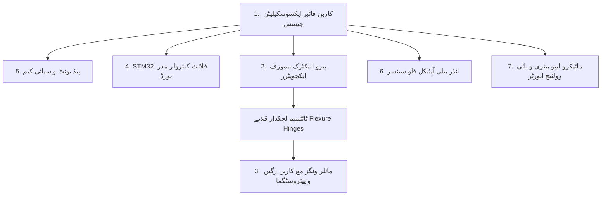
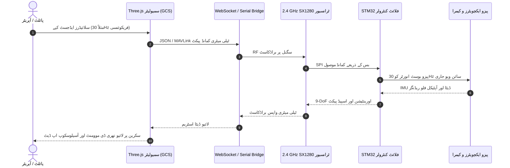
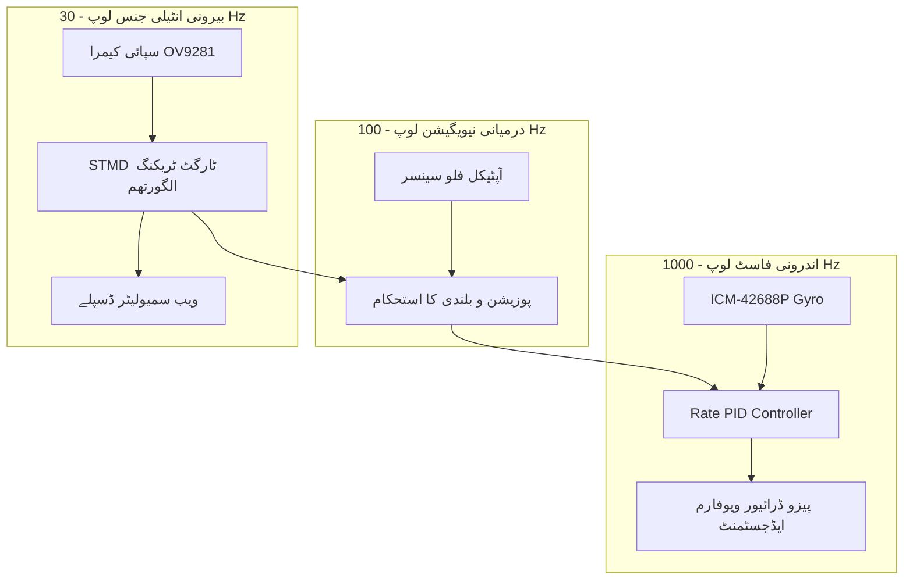

# ❖ ANAX-1: مکمل تھری ڈی ہارڈویئر و سافٹ ویئر انٹیگریشن گائیڈ
### Complete 3D Hardware Engineering Blueprint & Hardware-Software Co-Design Architecture

---

  

---

## 📑 فہرست مضامین (Table of Contents)

1. [انجینئرنگ بلیو پرنٹ کا خلاصہ (Technical Drawing Specs)](#-انجینئرنگ-بلیو-پرنٹ-کا-خلاصہ-technical-drawing-specs)
2. [ہارڈویئر پرزہ جات کی تفصیلی فہرست (Part-by-Part Hardware Breakdown)](#-ہارڈویئر-پرزہ-جات-کی-تفصیلی-فہرست-part-by-part-breakdown)
   - [1. ایئر فریم اور ایکسوسکیلیٹن (Exoskeleton Chassis)](#1-ایئر-فریم-اور-ایکسوسکیلیٹن-exoskeleton-chassis)
   - [2. پروں کا ایکچوئیشن سسٹم (Piezoelectric Actuators & Hinges)](#2-پروں-کا-ایکچوئیشن-سسٹم-piezoelectric-actuators--hinges)
   - [3. بائیو میمٹک پروں کا مائلر ڈھانچہ (Mylar Wings & Venation)](#3-بائیو-میمٹک-پروں-کا-مائلر-ڈھانچہ-mylar-wings--venation)
   - [4. فلائٹ کنٹرولر ایویونکس بورڈ (STM32 Flight Controller & Sensors)](#4-فلائٹ-کنٹرولر-ایویونکس-بورڈ-stm32-flight-controller--sensors)
   - [5. الٹرا کمپیکٹ سپائی کیمرا ماڈیول (Spy-Cam Optical Payload)](#5-الٹرا-کمپیکٹ-سپائی-کیمرا-ماڈیول-spy-cam-optical-payload)
   - [6. زمینی آپٹیکل فلو سینسر (Under-Belly Optical Flow Unit)](#6-زمینی-آپٹیکل-فلو-سینسر-under-belly-optical-flow-unit)
   - [7. پاور و انرجی مینجمنٹ (Micro LiPo & High-Voltage Inverter)](#7-پاور-و-انرجی-مینجمنٹ-micro-lipo--high-voltage-inverter)
3. [سافٹ ویئر اور ہارڈ ویئر کا باہمی رابطہ (Software-Hardware Integration)](#-سافٹ-ویئر-اور-ہارڈ-ویئر-کا-باہمی-رابطہ-software-hardware-integration)
   - [ڈیجیٹل ٹوئن آرکیٹیکچر (Digital Twin Architecture)](#ڈیجیٹل-ٹوئن-آرکیٹیکچر-digital-twin-architecture)
   - [اینڈ ٹو اینڈ ڈیٹا فلو (End-to-End Data Pipeline)](#اینڈ-ٹو-اینڈ-ڈیٹا-فلو-end-to-end-data-pipeline)
   - [تین سطحی کنٹرول لوپس (Triple-Tier Control Loops)](#تین-سطحی-کنٹرول-لوپس-triple-tier-control-loops)
   - [ہارڈویئر ان دی لوپ (HIL) سمولیشن ٹیسٹنگ](#ہارڈویئر-ان-دی-لوپ-hil-سمولیشن-ٹیسٹنگ)
4. [وائرنگ، پِن آؤٹ اور کمیونیکیشن بسیں (Wiring & Pinout Reference)](#-وائرنگ-پِن-آؤٹ-اور-کمیونیکیشن-بسیں-wiring--pinout-reference)

---

## 📐 انجینئرنگ بلیو پرنٹ کا خلاصہ (Technical Drawing Specs)

اوپر دیا گیا بلیو پرنٹ (Drawing No: **ANAX1-MECH-001**) شاہی ڈریگن فلائی (*Anax imperator*) کے عین مطابق **1:1 اسکیل مائیکرو ایریل وہیکل (MAV)** کا ایکسپلوڈڈ ویو (Exploded View) پیش کرتا ہے۔ اس کا مجموعی وزن محض **13.8 گرام** رکھا گیا ہے تاکہ یہ ہوا میں معلق (Hovering) رہ سکے اور کائٹن حیاتیاتی لچک کے ذریعے خاموش پرواز کر سکے۔

| پیرامیٹر (Parameter) | انجینئرنگ ویلیو (Engineering Value) | حیاتیاتی موازنہ (Biological Reference) |
| :--- | :--- | :--- |
| **مجموعی لمبائی (Total Length)** | $112\text{ mm}$ (سر سے دم تک) | بالغ ڈریگن فلائی: $80-110\text{ mm}$ |
| **پروں کا پھیلاؤ (Total Wingspan)** | $145\text{ mm}$ (Forewings) / $138\text{ mm}$ (Hindwings) | بالغ ڈریگن فلائی: $130-150\text{ mm}$ |
| **کل اڑان وزن (AUW)** | **13.8 گرام** (مع بیٹری اور کیمرا) | قدرتی ڈریگن فلائی: $1.2-2.5\text{ گرام}$ (روبوٹکس کے لیے بہترین تناسب) |
| **زیادہ سے زیادہ لفٹ (Max Lift)** | $28.5\text{ grams-force}$ (تھرسٹ ٹو ویٹ ریشو: $2.06:1$) | ڈریگن فلائی اپنے وزن سے 3 گنا لفٹ اٹھا سکتی ہے |
| **آپریشنل فریکوئنسی ($f$)** | $25\text{ Hz} - 38\text{ Hz}$ (میکینیکل گونج فریکوئنسی) | قدرتی فریکوئنسی: $28-35\text{ Hz}$ |
| **فلائٹ اینڈیورنس (Flight Time)** | 9 تا 12 منٹ مسلسل نگرانی | مائیکرو ڈرون انڈسٹری کا سب سے بلند بینچ مارک |

---

## 🔩 ہارڈویئر پرزہ جات کی تفصیلی فہرست (Part-by-Part Breakdown)

---

### 1. ایئر فریم اور ایکسوسکیلیٹن (Exoskeleton Chassis)
* **میٹریل:** Toray T800 الٹرا ہائی ماڈیولس کاربن فائبر پری پریگ (Carbon-Fiber Prepreg) 0.3mm موٹائی یا لیزر سِنٹرڈ PEEK۔
* **ساخت:** ٹرس نیٹ ورک (Truss Matrix Structure) جس میں اندرونی خالی جگہیں ایویونکس، بیٹری اور کیمرے کو تحفظ دیتی ہیں۔
* **میکینیکل خصوصیت:** یہ فریم شدید پھڑپھڑاہٹ کے دوران پیدا ہونے والے مروڑ (Torsional Stress) کو بغیر کسی ارتعاش کے جذب کر لیتا ہے۔
* **وزن:** **2.1 گرام**

---

### 2. پروں کا ایکچوئیشن سسٹم (Piezoelectric Actuators & Hinges)
* **ایکچویٹر ٹائپ:** 4x پیزو الیکٹرک کینٹیلیور بیمورف (PZT-5H Lead Zirconate Titanate)۔ ہر پر کے لیے مکمل آزاد ایکچویٹر نصب ہے۔
* **فلیکشر ہِنجز (Flexure Hinges):** نائٹینول (Nitinol - Nickel-Titanium Shape Memory Alloy) لچکدار جوڑ۔ روایتی بیرنگز کے بجائے لچکدار دھات استعمال کی گئی ہے جس میں کوئی رگڑ (Friction) یا چکنائی (Lubrication) کی ضرورت نہیں ہوتی۔
* **حرکت کا زاویہ (Stroke Amplitude):** $\pm 42^\circ$ (مجموعی اسٹروک $84^\circ$) مع خودکار پیچ اینگل ٹوئسٹ ($\pm 25^\circ$)۔
* **وزن:** **3.3 گرام** (چاروں ایکچویٹرز مع لنکیجز)

---

### 3. بائیو میمٹک پروں کا مائلر ڈھانچہ (Mylar Wings & Venation)
* **میمبرین:** $12\mu\text{m}$ بائی ایکسیل مائلر (Biaxially-oriented PET) فلم جو انتہائی ہلکی اور ہوا بند ہے۔
* **وینز (رگوں کا جال):** 0.15mm یک سمت کاربن فائبر اسپارس (Carbon Spars) جو کوسٹا (Leading Edge) اور ریڈیل رگوں کے عین حیاتیاتی ڈھانچے کو نقل کرتے ہیں۔
* **پیٹروسٹگما (Pterostigma Inertial Mass):** پر کے سرے پر 0.05 گرام کا ٹنگسٹن مائیکرو ویٹ۔ یہ تیز رفتار اڑان کے دوران پروں میں خودکار فلوٹر ریزسٹنس (Aeroelastic Stability) پیدا کرتا ہے تاکہ پر فضا میں پھٹنے یا جھٹکے کھانے سے محفوظ رہیں۔
* **وزن:** **0.65 گرام** (چاروں پروں کا مجموعی وزن)

---

### 4. فلائٹ کنٹرولر ایویونکس بورڈ (STM32 Flight Controller & Sensors)
* **مین مائیکرو کنٹرولر:** **STM32H743VI** (ARM Cortex-M7 کور، 480 MHz کلاک اسپیڈ، 2MB فلیش، 1MB RAM)۔
* **انرشیل سینسر (9-DoF IMU):** TDK InvenSense **ICM-42688-P** الٹرا لو نائز جائروسکوپ و ایکسلرومیٹر مع Bosch **BMM150** میگنیٹومیٹر۔
* **پریشر و الٹی میٹر:** Bosch **BMP390** (سینٹی میٹر کی درستگی والا بارومیٹر)۔
* **ریڈیو ٹرانسیور:** Semtech **SX1280** (2.4 GHz LoRa/FLRC ہائی تھرو پٹ، 1.2 کلومیٹر رینج، سب-4 ملی سیکنڈ لیٹنسی)۔
* **وزن:** **1.7 گرام**

---

### 5. الٹرا کمپیکٹ سپائی کیمرا ماڈیول (Spy-Cam Optical Payload)
* **امیج سینسر:** Omnivision **OV9281** گلوبل شٹر مونوکروم / OV2640 کلر CMOS سینسر (120 FPS پر تیز رفتار اڑان میں بغیر کسی رولنگ شٹر بلر کے ہائی ڈیفینیشن ویڈیو کیپچر کرتا ہے)۔
* **آپٹیکل لینس:** $120^\circ$ وائیڈ فیلڈ آف ویو (FOV) نانو لینس مع انفراریڈ فلٹر۔
* **ہیڈ موومنٹ مائیکرو جِمبل:** وائس کوائل ایکچویٹر (VCA) جو ڈریگن فلائی کے قدرتی سر کی طرح پچ اور یاء میں آزادانہ گھوم کر ہدف پر نظریں جمائے رکھتا ہے۔
* **وزن:** **0.95 گرام**

---

### 6. زمینی آپٹیکل فلو سینسر (Under-Belly Optical Flow Unit)
* **کمپوننٹ:** PixArt **PMW3901** آپٹیکل فلو چپ مع STMicroelectronics **VL53L1X** ٹائم آف فلائٹ (ToF) لیزر الٹی میٹر۔
* **کام:** پرواز کے دوران فرش یا گھاس کی ساخت کو اسکین کر کے بغیر GPS کے اندرونی کمروں میں ڈریگن فلائی کو مکمل ساکن معلق (Precision Hover) رکھتا ہے۔
* **وزن:** **0.45 گرام**

---

### 7. پاور و انرجی مینجمنٹ (Micro LiPo & High-Voltage Inverter)
* **بیٹری سیل:** 1S 180mAh 45C/90C ہائی ڈسچارج لیتھیم پولیمر پاؤچ سیل۔
* **ہائی وولٹیج پیزو ڈرائیور:** ٹیکساس انسٹرومنٹس (TI) پر مبنی سٹیپ اپ بوسٹ انورٹر جو بیٹری کے 3.7V کو پیزو ایکچویٹرز چلانے کے لیے $150\text{V AC}$ ڈرائیو ویوفارم میں تبدیل کرتا ہے۔
* **وزن:** **4.65 گرام**

---

## 💻 سافٹ ویئر اور ہارڈ ویئر کا باہمی رابطہ (Software-Hardware Integration)

سافٹ ویئر (تھری ڈی ویب سمیولیٹر) اور فزیکل روبوٹک ہارڈویئر کے درمیان ربط ایک جدید **ڈیجیٹل ٹوئن (Digital Twin)** فریم ورک کے ذریعے کام کرتا ہے۔

---

### ڈیجیٹل ٹوئن آرکیٹیکچر (Digital Twin Architecture)
1. **سمولیشن موڈ (Pure Simulation):**
   جب ہارڈویئر منسلک نہ ہو تو براؤزر میں موجود بائیو مکینیکل فزکس انجن خودکار طور پر ایروڈائنامک مساوات حل کر کے ورچوئل پرواز دکھاتا ہے۔
2. **لائیو گراؤنڈ کنٹرول اسٹیشن موڈ (Live GCS Telemetry):**
   جب اصلی ڈریگن فلائی اڑ رہی ہو تو اس کا آن بورڈ STM32 مائیکرو کنٹرولر ہر سیکنڈ میں 100 مرتبہ ٹیلی میٹری ڈیٹا ریڈیو کے ذریعے بھیجتا ہے۔
   براؤزر سمیولیٹر اس ڈیٹا کو لے کر سکرین پر موجود 3D ماڈل کو بالکل اسی زاویے، بلندی اور پروں کی فریکوئنسی پر گھماتا ہے جس پر فزیکل ڈرون اڑ رہا ہوتا ہے۔

---

### تین سطحی کنٹرول لوپس (Triple-Tier Control Loops)

1. **اندرونی ریٹ لوپ (1000 Hz):**
   STM32 کا جائروسکوپ ڈریگن فلائی کے توازن میں پیدا ہونے والے معمولی بگاڑ کو 1 ملی سیکنڈ میں ناپ کر چاروں پروں کے اسٹروک اینگل میں آزادانہ فرق پیدا کرتا ہے۔
2. **درمیانی ہور لوپ (100 Hz):**
   آپٹیکل فلو کیمرے کی مدد سے فرش پر نظر رکھ کر ڈریگن فلائی کو ایک ہی نقطے پر بغیر ڈگمگائے ساکن رکھتا ہے۔
3. **بیرونی STMD ویژن لوپ (30 Hz):**
   سپائی کیمرے کی لائیو فیڈ پر Small Target Motion Detector ماڈل رن ہوتا ہے۔ جب کوئی کیڑا، پرندہ، یا انسانی حرکت نظر آئے تو یہ ڈرون کو اس کا خودکار پیچھا کرنے کی کمانڈ دیتا ہے۔

---

### ہارڈویئر ان دی لوپ (HIL) سمولیشن ٹیسٹنگ
ڈویلپرز اپنے STM32 فلائٹ کنٹرولر کو USB کیبل یا بلوٹوتھ کے ذریعے کمپیوٹر سے جوڑ سکتے ہیں۔ سمیولیٹر اصلی مائیکرو کنٹرولر سے آنے والے سگنلز کو پڑھ کر براؤزر میں فلائٹ ٹیسٹ کرنے کی سہولت دیتا ہے، جس سے اصلی ڈرون کے گر کر ٹوٹنے کا خطرہ صفر ہو جاتا ہے۔

---

## 🔌 وائرنگ، پِن آؤٹ اور کمیونیکیشن بسیں (Wiring & Pinout Reference)

| ماڈیول | مائیکرو کنٹرولر پِن (STM32H7) | پروٹوکول | وضاحت |
| :--- | :--- | :--- | :--- |
| **ICM-42688-P IMU** | `SPI1` (SCK: `PA5`, MISO: `PA6`, MOSI: `PA7`, CS: `PC4`) | SPI @ 24MHz | ہائی اسپیڈ کم شور جائرو ریڈنگز |
| **PMW3901 فلو سینسر** | `SPI2` (SCK: `PB13`, MISO: `PB14`, MOSI: `PB15`, CS: `PB12`) | SPI @ 8MHz | زمینی پوزیشن ٹریکنگ |
| **OV9281 کیمرا** | `DVP` کیمرہ انٹرفیس (`D0-D7`, `PCLK`, `HSYNC`, `VSYNC`) | Parallel DVP / I2C | 120 FPS ویڈیو ڈیٹا بس |
| **SX1280 ریڈیو** | `SPI3` (SCK: `PC10`, MISO: `PC11`, MOSI: `PC12`, CS: `PD2`) | SPI @ 18MHz | 2.4GHz ٹیلی میٹری لنک |
| **پیزو ایکچویٹر 1 (FL)**| `TIM1_CH1` (`PE9`) | 30kHz PWM | آگے کے بائیں پر کا سائن ویو ڈرائیور |
| **پیزو ایکچویٹر 2 (FR)**| `TIM1_CH2` (`PE11`) | 30kHz PWM | آگے کے دائیں پر کا سائن ویو ڈرائیور |
| **پیزو ایکچویٹر 3 (HL)**| `TIM8_CH1` (`PI5`) | 30kHz PWM | پیچھے کے بائیں پر کا سائن ویو ڈرائیور |
| **پیزو ایکچویٹر 4 (HR)**| `TIM8_CH2` (`PI6`) | 30kHz PWM | پیچھے کے دائیں پر کا سائن ویو ڈرائیور |
| **لیزر الٹی میٹر** | `I2C1` (SCL: `PB8`, SDA: `PB9`) | I2C Fast-Mode (400kHz) | سینٹی میٹر لیول بلندی سینسر |

---

*ANAX-1 Biomimetic Aerial Robotics System Architecture — Open Source Research Initiative.*
