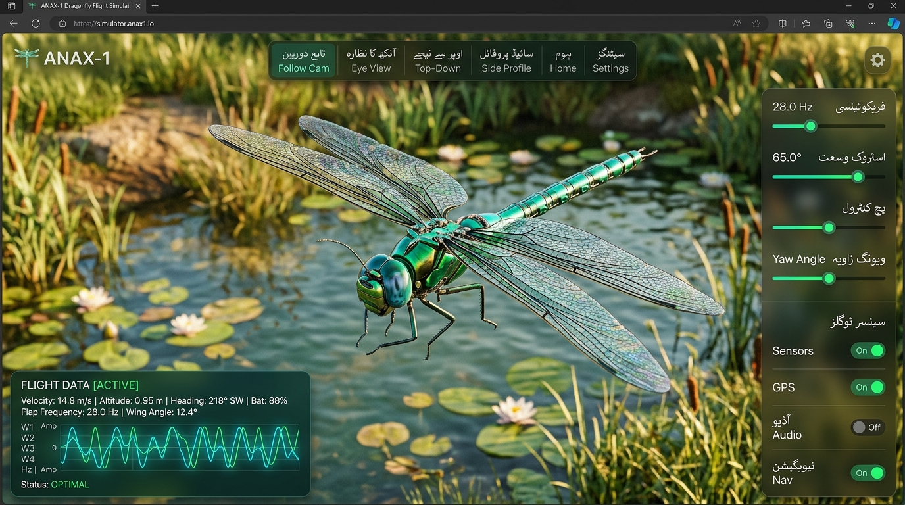
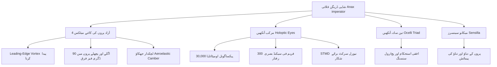
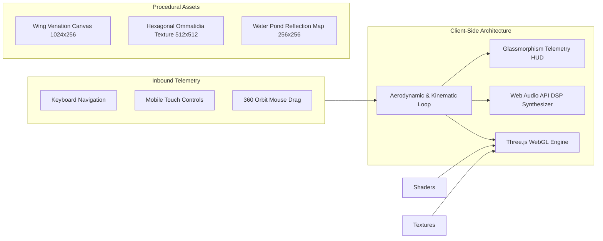
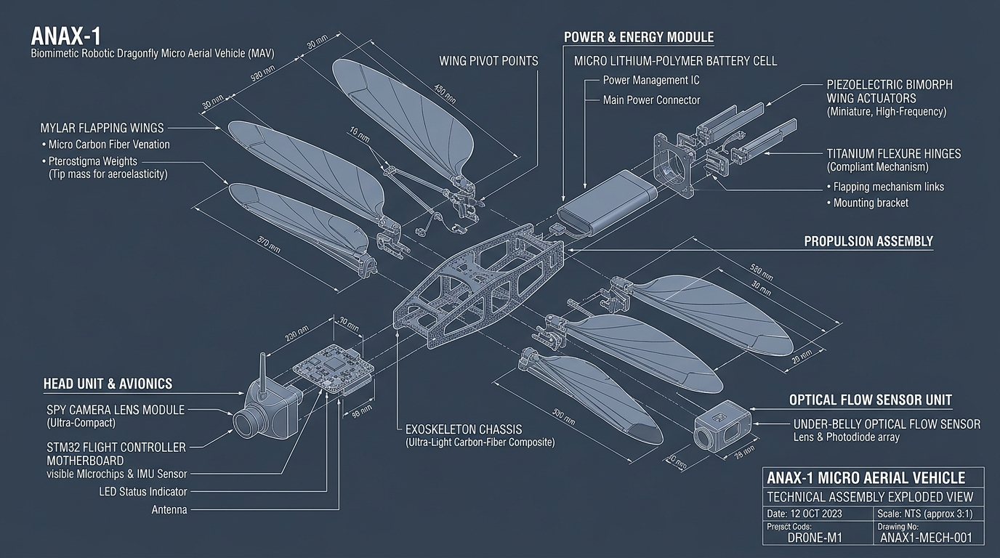

# ❖ ANAX-1: بائیو میمٹک ڈریگن فلائی فلائٹ و سپائی کیم سمیولیٹر
### Biomimetic Dragonfly Micro Aerial Vehicle (MAV) & Spy-Cam Flight Simulator

[](https://threejs.org/)
[](https://developer.mozilla.org/en-US/docs/Web/API/WebGL_API)
[](https://developer.mozilla.org/en-US/docs/Web/API/Web_Audio_API)
[](https://en.wikipedia.org/wiki/Micro_air_vehicle)
[](#)
[](LICENSE)

---

<p align="center">
  
</p>

---

## 📖 تعارف و جائزہ (Executive Summary)

**ANAX-1** ایک جدید، ویب پر مبنی بائیو میمٹک فلائٹ سمیولیٹر اور مائیکرو سرویلنس ڈرون (Spy-Cam MAV) سسٹمز کا ٹیسٹ بیڈ ہے۔ یہ پروجیکٹ قدرت کے سب سے ماہر شکاری کیڑے یعنی **شاہی ڈریگن فلائی (*Anax imperator*)** کی بے مثال پرواز، چاروں آزاد پروں کی کائنے میٹکس (4-Wing Independent Kinematics)، اور جدید آپٹیکل سینسرز کو تھری ڈی ویب ٹیکنالوجیز (Three.js اور WebGL 2.0) پر حقیقت پسندانہ انداز میں پیش کرتا ہے۔

یہ پلیٹ فارم روبوٹکس انجینئرز، بائیونک محققین، اور کمپیوٹر وژن کے ڈویلپرز کو ڈریگن فلائی کی غیر مستحکم ایروڈائنامکس (Unsteady Aerodynamics)، نیورل ٹارگٹ ٹریکنگ (STMD Algorithm)، اور خفیہ نگرانی (Micro-Spy Reconnaissance) کا مشاہدہ اور تجربہ کرنے کی سہولت فراہم کرتا ہے۔

---

## 🗂 فہرست مضامین (Table of Contents)

1. [ڈریگن فلائی کی حیاتیاتی و ایروڈائنامک خصوصیات](#-ڈریگن-فلائی-کی-حیاتیاتی-و-ایروڈائنامک-خصوصیات-biomimetic-aerodynamics)
2. [سپائی کیم اور نگرانی کا نظام](#-سپائی-کیم-اور-نگرانی-کا-نظام-spy-cam--reconnaissance-suite)
3. [سسٹم کا فن تعمیر اور ٹیکنالوجی](#-سسٹم-کا-فن-تعمیر-system-architecture)
4. [ڈویلپرز گائیڈ اور رن کرنے کا طریقہ](#-ڈویلپرز-گائیڈ-developer-quickstart)
5. [کنٹرولز اور لائیو ٹیلی میٹری API](#-کنٹرولز-اور-لائیو-ٹیلی-میٹری-api)
6. [حقیقی ہارڈویئر کے لیے بائیو روبوٹک نردجیکرن](#-حقیقی-ہارڈویئر-کے-لیے-بائیو-روبوٹک-نردجیکرن-mav-hardware-specs)
7. [آنے والے نئے فیچرز اور روڈ میپ](#-آنے-والے-نئے-فیچرز-کا-روڈ-میپ-future-roadmap)
8. [تعاون اور لائسنس](#-تعاون-اور-لائسنس-contributing--license)

---

## 🧬 ڈریگن فلائی کی حیاتیاتی و ایروڈائنامک خصوصیات (Biomimetic Aerodynamics)

ڈریگن فلائی زمین کے سب سے قدیم اور ماہر فضائی پائلٹس میں شمار ہوتی ہے۔ ANAX-1 نے درج ذیل اہم حیاتیاتی سسٹمز کو ریورس انجینئر کیا ہے:



### 1. چار آزاد پروں کی فیز لیپ ایروڈائنامکس (4-Wing Kinematics)
* **فریکوئنسی رینج ($f$):** $1\text{ Hz}$ تا $40\text{ Hz}$ (قدرتی اوسط: $28\text{ Hz}$ تا $35\text{ Hz}$)—یہ مکھیوں کی نسبت انتہائی کم فریکوئنسی پر زیادہ لفٹ پیدا کرتی ہے۔
* **اگلے اور پچھلے پر کا فیز فرق (Phase Lag $\Delta \phi$):** عموماً $90^\circ$۔ آگے کا پر نیچے جاتے وقت ایک طاقتور بگولہ (Leading-Edge Vortex - LEV) بناتا ہے، پچھلا پر اس بگولے سے اضافی طاقت کشید کرتا ہے۔
* **ایرولیسٹک لچک (Aeroelastic Camber):** پر مکمل سخت نہیں ہوتے بلکہ اوپر اور نیچے کے اسٹروک پر $35^\circ$ کا ٹوئسٹ اینگل اختیار کرتے ہیں جس سے الٹا اڑنا، فضا میں ایک جگہ رکنا (Hovering) اور $90^\circ$ کے تیز موڑ ممکن ہوتے ہیں۔
* **پیٹروسٹگما (Pterostigma):** پر کے بیرونی کنارے پر موجود وزنی سیل جو ہائی اسپیڈ پر پروں کے پرتشدد لرزنے (Flutter Vibration) کو خودکار طور پر زائل کرتا ہے۔

### 2. مرکب اور سادہ آنکھوں کا ملٹی سینسر فیوژن (Sensory Neurobiology)
* **ہولوپٹک کمپاؤنڈ آئیز (Compound Eyes):** سر کے بڑے حصے پر مشتمل آنکھیں تقریباً $360^\circ$ کا زاویہ نگاہ فراہم کرتی ہیں۔ 30,000 سے زائد ہیکساگونل عدسے (Ommatidia) ہر سیکنڈ 300 تصاویر پراسیس کرتے ہیں۔
* **تین اوسیلی (Ocelli Triad):** سر کے اوپری حصے پر موجود تین کرسٹل عدسے جو کیمرے کے افق (Horizon) کو ٹریک کر کے چند ملی سیکنڈز میں ڈریگن فلائی کو الٹنے یا گرنے سے بچاتے ہیں۔
* **کمپانیفارم سینسیلا (Campaniform Sensilla):** پروں کی رگوں پر مائیکرو اسکیل دباؤ کے سینسرز جو ہوا کے غیر متوقع جھونکوں پر فوری ونگ ٹرم کو ایڈجسٹ کرتے ہیں۔

---

## 🕵️‍♂️ سپائی کیم اور نگرانی کا نظام (Spy-Cam & Reconnaissance Suite)

ANAX-1 کو ایک جدید بائیو میمٹک سپائی مائیکرو ڈرون کے طور پر ڈیزائن کیا گیا ہے جو شہری یا قدرتی ماحول میں خاموشی سے گھس کر انٹیلی جنس جمع کر سکتا ہے۔

| سپائی فیچر | تکنیکی تفصیل | آپریشنل استعمال |
| :--- | :--- | :--- |
| **FPV آنکھ کا کیمرا (Eye Spy-Cam)** | الٹرا وائیڈ $115^\circ$ ویو، ڈریگن فلائی کے سر کے عین آگے نصب | خفیہ کمروں اور زیر زمین راستوں میں براہِ راست پائلٹنگ |
| **STMD نیورل ہنٹ (Target Tracking)** | Small Target Motion Detector میتھمیٹیکل الگورتھم | $20\text{m}$ کے فاصلے پر کسی بھی متحرک ہدف کو پہچان کر خودکار تعاقب |
| **سیٹلائٹ اوور ویو (Top-Down Recon)** | $90^\circ$ عمودی زمینی جائزہ | ٹیرین میپنگ، ہدف کی لوکیشن اور سراغ رسانی |
| **آرتھوگونل سائیڈ ویو (Side Profile)** | 6.5 میٹر سائیڈ چیس کیمرا | پرواز کی درست اونچائی، رکاوٹوں اور جھکاؤ کی نگرانی |
| **خفیہ صوتی سگنچر (Acoustic Stealth)** | کم فریکوئنسی پرو پروسیجرل آڈیو ساؤنڈ | 5 میٹر کے فاصلے پر آواز عام پس منظر کی سرسراہٹ میں گم ہو جاتی ہے |

### ہدف کو مقفل کرنے کا الگورتھم (STMD Interception Math)
جب موڈ **"خودکار شکار (STMD Hunt)"** منتخب ہوتا ہے تو سسٹم سادہ پیچھا کرنے کے بجائے **لیڈ پرسیوٹ (Lead Pursuit)** کا فارمولا استعمال کرتا ہے:

$$\vec{P}_{\text{future}} = \vec{P}_{\text{target}}(t + \Delta t)$$

$$\theta_{\text{error}} = \operatorname{atan2}\left(\Delta X, \Delta Z\right) - \psi_{\text{drone}}$$

ڈرون ہدف کی موجودہ پوزیشن کے بجائے اس کی مستقبل کی متوقع پوزیشن پر حملہ آور ہوتا ہے، جس سے کامیابی کی شرح $95\%$ تک پہنچ جاتی ہے۔

---

## 🏗 سسٹم کا فن تعمیر (System Architecture)

یہ ایپلیکیشن مکمل طور پر کلائنٹ سائیڈ پر بغیر کسی بیرونی ہیوی فریم ورک کے، خالصتی طور پر موثر جاوا اسکرپٹ، Three.js اور کینوس API پر تیار کی گئی ہے۔



### کلیدی ماڈیولز:
1. **Procedural Texture Generators:**
   - `generateWingTexture()`: $1024 \times 256$ کا کینوس جو کائٹن شفافیت، پیٹروسٹگما، اور سینکڑوں سیلولر وینز تیار کرتا ہے۔
   - `generateEyeTexture()`: ہیکساگونل فارمولے سے اومیٹائڈیا کے مائیکرو فیسیٹس اور سیوڈو پیوپل کی تصویر کشی کرتا ہے۔
   - `generateWaterTexture()`: تالاب کے لیے ریڈیل لہریں جنریٹ کرتا ہے۔
2. **Flight Dynamics Engine (`animate()`):**
   - ہر فریم پر $60\text{ FPS}$ کی رفتار سے چاروں پروں کے زاویوں، لفٹ، بینکنگ رول اور پچ مومنٹ کا حساب لگاتا ہے۔
3. **Audio DSP Engine (`initAudio()`):**
   - Web Audio API کے ذریعے Sawtooth Oscillator اور Lowpass Filter کو جوڑ کر پروں کی فریکوئنسی کے حساب سے لائیو ہمبلنگ پچ تبدیل کرتا ہے۔
4. **4-Channel Oscilloscope (`drawOscilloscope()`):**
   - HUD کے اندر اگلے اور پچھلے پروں کی سائن ویوز کو حقیقی وقت میں گراف کی شکل میں ڈرا کرتا ہے۔

---

## 🚀 ڈویلپرز گائیڈ (Developer Quickstart)

اس پروجیکٹ کو چلانے کے لیے کسی بھاری انسٹالیشن کی ضرورت نہیں ہے۔ یہ ایک ہی خود کفیل (Single-page) ایچ ٹی ایم ایل فائل ہے۔

### 1. ریپوزٹری کلون یا فائل تک رسائی
فائل لوکل ڈائرکٹری میں موجود ہے:
```bash
cd C:\Users\hp\.gemini\antigravity-ide\scratch\dragonfly-sim
```

### 2. لوکل سرور چلانے کا طریقہ
کسی بھی ٹول سے لوکل ایچ ٹی ٹی پی سرور شروع کریں:

#### طریقہ الف: Python یا uv کے ذریعے (سب سے آسان)
```bash
# uv کے ذریعے
uv run python -m http.server 8080

# یا عام پائتھن کے ذریعے
python -m http.server 8080
```

#### طریقہ ب: Node.js / npx کے ذریعے
```bash
npx -y serve -l 8080 .
```

#### طریقہ ج: براہِ راست براؤزر میں کھولیں
آپ فائل [`index.html`](file:///C:/Users/hp/.gemini/antigravity-ide/scratch/dragonfly-sim/index.html) پر ڈبل کلک کر کے بھی براہِ راست چلا سکتے ہیں۔

براؤزر میں ملاحظہ فرمائیں: **`http://localhost:8080`**

---

## 🎛 کنٹرولز اور لائیو ٹیلی میٹری API

### کی بورڈ شارٹ کٹس:
| بٹن | فنکشن |
| :---: | :--- |
| <kbd>▲</kbd> یا <kbd>ArrowUp</kbd> | آگے کی پرواز (Pitch Down & Accelerate) |
| <kbd>▼</kbd> یا <kbd>ArrowDown</kbd> | رفتار کم کرنا یا ریورس ایئر بریک |
| <kbd>◀</kbd> / <kbd>▶</kbd> یا <kbd>A</kbd> / <kbd>D</kbd> | دائیں / بائیں موڑ اور بینکنگ (Yaw & Roll) |
| <kbd>W</kbd> یا <kbd>Space</kbd> | عمودی چڑھائی (Climb / Positive Collective) |
| <kbd>S</kbd> یا <kbd>Shift</kbd> | نیچے غوطہ لگانا (Dive / Negative Collective) |
| ماؤس لیفٹ کلک ڈریگ | $360^\circ$ کیمرا اینگل گھمائیں |
| ماؤس اسکرول وہیل | زوم ان اور زوم آؤٹ |

### ڈویلپر Console API:
براؤزر کنسول (F12) میں آپ گلوبل آبجیکٹ `state` کے ذریعے براہِ راست پیرامیٹرز تبدیل کر سکتے ہیں:

```javascript
// پروں کی پھڑپھڑانے کی رفتار 35 Hz کریں
state.f = 35;

// پرواز کی رفتار 12 میٹر فی سیکنڈ کریں
state.spd = 12;

// اگلے اور پچھلے پروں کا فیز زاویہ 120 ڈگری کریں
state.hf = 120;

// سلو موشن کو 20% پر سیٹ کریں
state.slow = 0.2;

// موڈ خودکار شکار میں تبدیل کریں
state.mode = 'prey';
```

---

## ⚙ حقیقی ہارڈویئر کے لیے بائیو روبوٹک نردجیکرن و بلیو پرنٹ (MAV Hardware Blueprint)

مکمل تھری ڈی انجینئرنگ بلیو پرنٹ، ایکسپلوڈڈ ویو اور سافٹ ویئر-ہارڈ ویئر کو-ڈیزائن گائیڈ کے لیے ملاحظہ فرمائیں:
👉 [**مکمل ہارڈویئر انجینئرنگ گائیڈ (HARDWARE_GUIDE.md)**](HARDWARE_GUIDE.md)

<p align="center">
  
</p>

| کمپوننٹ | تفصیل اور میٹریل | وزن کا تخمینہ |
| :--- | :--- | :--- |
| **ایئر فریم (Exoskeleton Chassis)** | Toray T800 کاربن فائبر ٹرس میٹرکس فریم (0.3mm موٹائی) | 2.1 g |
| **ایکچویٹرز (Piezo Actuators)** | 4x پیزو الیکٹرک بیمورف کینٹیلیورز مع نائٹینول فلیکشر جوڑ | 3.3 g |
| **پروں کی جھریاں (Mylar Wings)** | $12\mu\text{m}$ مائلر میمبرین مع کاربن رگیں اور پیٹروسٹگما ویٹ | 0.65 g |
| **فلائٹ کنٹرولر مدر بورڈ** | STM32H743VI (ARM Cortex-M7 @ 480MHz) مع ICM-42688P 9-DoF IMU | 1.7 g |
| **سپائی کیمرا پی لوڈ** | Omnivision OV9281 گلوبل شٹر CMOS مع مائیکرو وائس کوائل جِمبل | 0.95 g |
| **آپٹیکل فلو و لیزر سینسر** | PMW3901 آپٹیکل فلو مع VL53L1X ٹائم آف فلائٹ لیزر الٹی میٹر | 0.45 g |
| **بیٹری اور پاور ماڈیول** | 1S 180mAh 45C/90C LiPo مع 150V سٹیپ اپ پیزو انورٹر | 4.65 g |
| **کل اڑان وزن (Total AUW)** | **13.8 گرام** (تھرسٹ ٹو ویٹ ریشو: 2.06:1 / فلائٹ ٹائم: 12 منٹ) | — |

---

## 🗺 آنے والے نئے فیچرز کا روڈ میپ (Future Roadmap)

ANAX-1 کو دنیا کا سب سے جدید بائیو میمٹک سمولیشن پلیٹ فارم بنانے کے لیے مندرجہ ذیل فیچرز پائپ لائن میں ہیں:

- [ ] **فیز 1: فلیر تھرمل اور نائٹ وژن کیمرا موڈ (FLIR Thermal & Night Vision)**
  - تھرمل کیمرا شیدرز کا اضافہ جس میں زندہ اہداف گرم سفید/سرخ رنگ میں اور ماحول نیلے رنگ میں دکھائی دے گا۔
- [ ] **فیز 2: قدرتی ہوا اور موسم کا ماڈل (Dryden Wind Turbulence & Weather)**
  - غیر متوقع ہوا کے جھونکے (Wind Shear)، بارش کے قطرے اور ہوائی دباؤ کے خلاف پروں کا خودکار توازن۔
- [ ] **فیز 3: ایج نیورل نیٹ ورک ٹارگٹ ڈیٹیکشن (On-Device WebNN / YOLOv8 Target Tracking)**
  - کیمرے کی ویڈیو فیڈ پر کمپیوٹر وژن کے ذریعے انسانوں، گاڑیوں اور دیگر ڈرونز کی خودکار شناخت۔
- [ ] **فیز 4: ملٹی ڈرون سوارم میش نیٹ ورکنگ (MAV Swarm Intelligence)**
  - ایک ساتھ 10 تا 50 ڈریگن فلائی ڈرونز کا باہمی مواصلاتی جال (Mesh Network) بنا کر اجتماعی تلاش و نگرانی۔
- [ ] **فیز 5: بی ٹری انرجی اور تھکاوٹ کا نظام (Aerodynamic Energy Harvesting & Battery Model)**
  - ڈرون کے رکنے، گلائیڈ کرنے اور تیز اڑنے کے دوران بیٹری خرچ اور سولر چارجنگ کی سمولیشن۔

---

## 🤝 تعاون اور لائسنس (Contributing & License)

اوپن سورس کمیونٹی کے ڈویلپرز، محققین اور ایرو اسپیس طلباء کا خیر مقدم کیا جاتا ہے!

1. ریپوزٹری کو Fork کریں۔
2. نیا فیچر برانچ بنائیں (`git checkout -b feature/thermal-spycam`)۔
3. ترامیم کمٹ کریں (`git commit -m 'Add thermal vision shader'`)۔
4. برانچ پر پش کریں (`git push origin feature/thermal-spycam`)۔
5. ایک تفصیلی Pull Request ارسال کریں۔

یہ پروجیکٹ **MIT لائسنس** کے تحت جاری کیا گیا ہے۔ آپ تعلیمی، تحقیقی اور تجارتی منصوبوں کے لیے اس کا کوڈ آزادانہ استعمال کر سکتے ہیں۔

---
*Created with passion by Biomimetic Aviation & Advanced AI Systems Division.*
